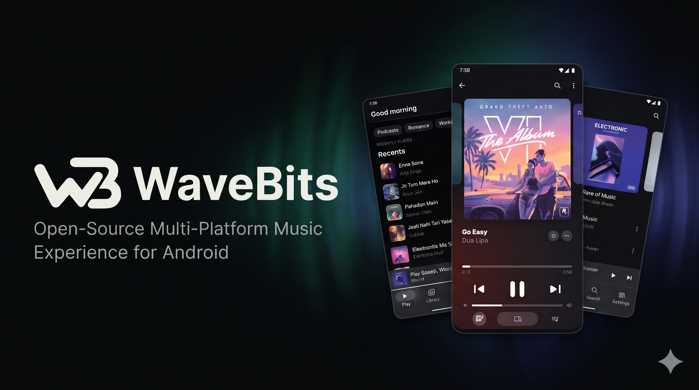
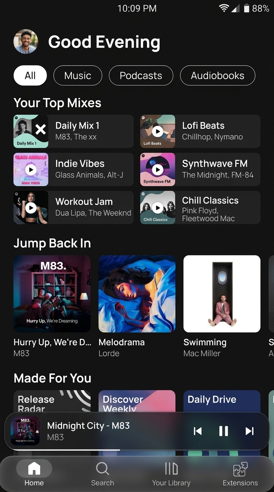
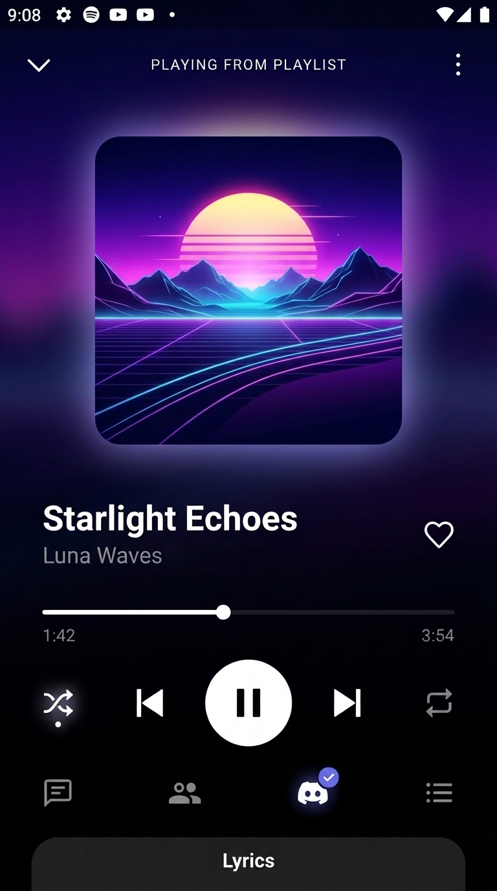
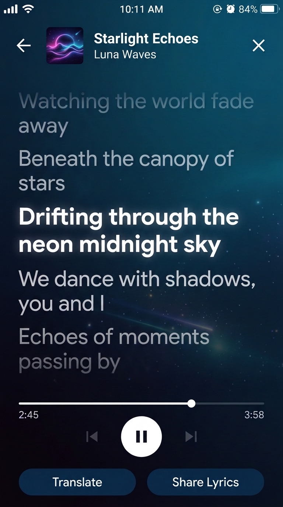
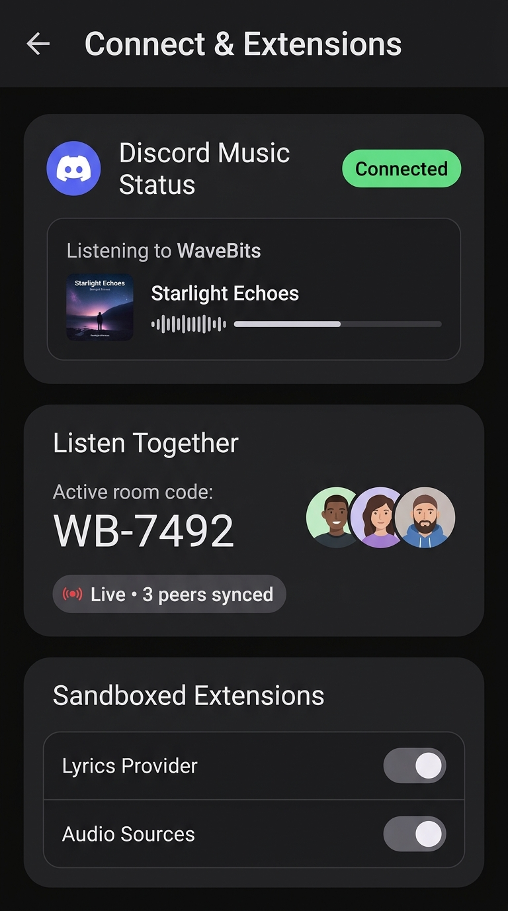

<div align="center">



<br />
<br />

# WaveBits

**An open-source, multi-platform Android music experience built with Jetpack Compose and Material 3.**

[](https://developer.android.com)
[](https://kotlinlang.org)
[](LICENSE)
[](#building-from-source)

[Features](#-features) • [Screenshots](#-screenshots) • [Architecture](#-project-architecture) • [Security](#-security--privacy) • [Build](#-building-from-source) • [License](#-license)

</div>

---

## ✨ Overview

**WaveBits** brings together your music discovery, library management, time-synced lyrics, offline encrypted downloads, social listening rooms, Discord Rich Presence, and a sandboxed JavaScript extension system in a fast, fluid dark-OLED Android app.

Built natively with **Kotlin**, **Jetpack Compose**, **Media3 / ExoPlayer**, and **Material Design 3**, WaveBits is engineered for 60fps+ animations, low power consumption, and strict on-device privacy.

---

## 📱 Screenshots

<div align="center">

| Home & Discovery | Now Playing | Time-Synced Lyrics | Social & Extensions |
| :---: | :---: | :---: | :---: |
|  |  |  |  |
| Personalized mixes, source switching, floating glass navigation | Dynamic artwork gradients, smooth seek bar, quick actions | Live glowing synced lyrics with translation & sharing | Discord Music Status, Listen Together rooms, sandboxed plugins |

</div>

---

## 🚀 Features

### 🎵 Multi-Source Music & Playback
- **Unified Listening Experience:** Stream and browse across Spotify, YouTube Music, JioSaavn, and local device audio files from one cohesive interface.
- **High-Performance Audio Engine:** Powered by AndroidX Media3 / ExoPlayer with gapless playback, queue management, podcasts, and Android Auto (`MediaBrowserService`) support.
- **Offline Encrypted Library:** Save tracks and playlists for offline playback with hardware-backed Android KeyStore AES-256 encryption so downloaded media stays protected on your device.

### 🎨 Modern Fluid UI
- **Immersive Glass & OLED Aesthetics:** Dynamic album-artwork header gradients, frosted glass floating navigation pill, true AMOLED black mode, and adaptive layouts for phones, foldables, and tablets.
- **60fps Animations & Power Policy:** Spring-tuned touch interactions, smooth scrolling, and a smart Battery Saver policy that automatically reduces background work on battery and restores full visual fidelity while charging.
- **Time-Synced Lyrics:** Full-screen live lyrics with smooth auto-scroll, translations, and quick lyric sharing.

### 🤝 Social & Extensibility
- **Discord Music Status (RPC):** Display your currently playing WaveBits track on Discord with artwork, timestamps, and clean status formatting.
- **Listen Together:** Create or join real-time PeerJS listening rooms with automatic playback drift correction and host/guest control permissions.
- **Sandboxed Extensions System:** Extend audio sources, lyrics providers, and custom pages using isolated Rhino JS runtimes with explicit per-extension capability grants and strict network/host allowlists.

---

## 🏗 Project Architecture

WaveBits is structured as a multi-module Gradle Kotlin project:

```text
WaveBits/
├── app/              # Jetpack Compose UI, Navigation, Media3 playback, Discord RPC, Listen Together, Offline Crypto
├── api/              # Core shared music models & API contracts
├── api-spotify/      # Spotify protocol & endpoint integration
├── host-android/     # Android runtime host, WebPlayerHost, YouTube & JioSaavn clients
├── innertube/        # InnerTube (YouTube Music) extractor & client module
├── extensions/       # Sandboxed Rhino JS extension engine, manifest permissions, CSP & HTTP guardrails
├── docs/screenshots/ # App showcase visuals for documentation
└── licenses/         # Third-party open-source license texts (Apache-2.0, OFL-1.1)
```

---

## 🔒 Security & Privacy

WaveBits follows defense-in-depth practices on Android:

- **Encrypted On-Device Credentials:** Session tokens and OAuth secrets are stored using `EncryptedSharedPreferences` (`AES256_SIV` / `AES256_GCM`) and Android KeyStore `AES-256-GCM` keys—never in plaintext.
- **HTTPS-Only Release Networking:** `network_security_config.xml` enforces strict TLS (`cleartextTrafficPermitted="false"`) in release builds, with `localhost` cleartext scoped solely to `<debug-overrides>`.
- **Hardened WebViews & Extension Sandbox:** File/content URL access is disabled, Safe Browsing is enabled, Discord/OAuth navigation is origin-allowlisted, and sandboxed extension network requests enforce strict security headers (`X-Content-Type-Options`, `X-Frame-Options`, `Referrer-Policy`, `Cross-Origin-Resource-Policy`) plus DNS-rebinding SSRF blocking.
- **Authenticated P2P Rooms & Rate Limiting:** Listen Together validates PeerJS envelope senders, enforces host/guest roles, sanitizes metadata, and rate-limits incoming messages. Exported components (`ArtworkProvider`) and debug-only CLI routes apply strict URL validation, caller UID checks, and rate limits.
- **Diagnostic Log Redaction:** Exportable diagnostic logs automatically mask Bearer tokens, YouTube auth cookies, Discord tokens, and email addresses.

---

## 🛠 Building from Source

### Prerequisites
- **Android Studio** (Ladybug or newer recommended) or JDK 17+
- **Android SDK 36** (`minSdk 26`, `targetSdk 35`)

### Build Commands

1. **Clone the repository**
   ```bash
   git clone https://github.com/tpxlegend/WaveBits.git
   cd WaveBits
   ```

2. **Optional environment configuration**
   Copy `.env.example` if you want to configure optional release update metadata (never commit real secrets or keystores):
   ```bash
   cp .env.example .env
   ```

3. **Assemble the Debug APK**
   ```bash
   ./gradlew :app:assembleDebug
   ```

4. **Run Unit & Security Tests**
   ```bash
   ./gradlew :app:testDebugUnitTest :extensions:test
   ```

> **Note:** Debug signing uses the project's debug keystore configuration automatically. For production release builds, configure signing credentials via environment variables (`MYSPOTI_KEYSTORE`, `MYSPOTI_KEYSTORE_PASSWORD`, `MYSPOTI_KEY_ALIAS`, `MYSPOTI_KEY_PASSWORD`).

---

## 🙌 Attribution & Third-Party Notices

WaveBits builds upon and credits the open-source Android community:
- **InnerTube** (`innertube` / NewPipeExtractor) — GPL-3.0
- **Spotui** (`Spotui/Spotui`) — GPL-3.0
- **Backdrop Glass Effects** (`Kyant0/backdrop`) — Apache License 2.0 (`licenses/Apache-2.0.txt`)
- **Manrope & Inter Typefaces** — SIL Open Font License 1.1 (`licenses/Manrope-OFL.txt`, `licenses/Inter-OFL.txt`)

---

## 📄 License

**WaveBits** is free and open-source software licensed under the **GNU General Public License v3.0 (GPL-3.0)**.

You are free to use, study, modify, and redistribute this software under the terms of the GPL-3.0 license, provided that derivative works retain attribution notices and publish their full source code under GPL-3.0. See the [LICENSE](LICENSE) file for full details.
